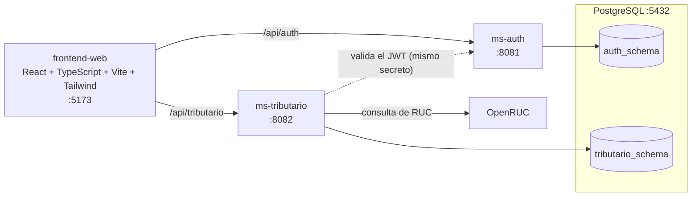

# PLUS CONTABLE

Sistema web de gestión tributaria para estudios contables que atienden a clientes MYPE. Centraliza el expediente de cada cliente, sus obligaciones tributarias y el calendario de vencimientos.

- **Cliente:** V&F Asesores Empresarial.
- **Curso:** Ingeniería de Software I, Universidad Peruana Unión.
- **Estado:** Sprint 1 cerrado (tag `sprint-1`) · Sprint 2 en curso.

## Contenido

[El problema](#el-problema-que-resuelve) · [Qué hace](#qué-hace-el-sistema) · [Sprints](#sprints) · [Arquitectura](#arquitectura) · [Tecnologías](#tecnologías) · [Ejecutar en local](#cómo-ejecutarlo-en-local) · [Seguridad](#seguridad) · [Documentación](#documentación) · [Metodología](#metodología) · [Equipo](#equipo)

## El problema que resuelve

Un estudio contable lleva decenas de clientes, cada uno con su régimen, su RUC y sus fechas límite de SUNAT. Cuando el expediente, los documentos y los vencimientos viven en archivos sueltos, se pierden plazos y cuesta saber qué falta por declarar o pagar.

- **Al contador** le da un solo lugar para el expediente del cliente, la programación mensual de obligaciones, el calendario de vencimientos y el registro de lo declarado.
- **Al cliente MYPE** le prepara el camino para ver su propia información y sus constancias (acceso del cliente: planificado para el Sprint 2, ver abajo). Hoy el sistema ya separa los datos de cada cliente por permisos.

## Qué hace el sistema

### Ya implementado y fusionado en `develop`/`main` (Sprint 1)

Comprobado contra el código de `develop`:

- **Expediente del cliente:** ficha maestra con consulta de RUC (OpenRUC) al registrar, socios y capital, nómina de trabajadores con su sistema pensionario, documentos del expediente y acuerdo de honorarios.
- **Obligaciones:** programación mensual de las obligaciones del cliente según el cronograma SUNAT 2026 ([`docs/cronograma_sunat_2026.md`](docs/cronograma_sunat_2026.md)).
- **Calendario de vencimientos:** vista de los vencimientos con días restantes y vencidos, con su pantalla.
- **Declaración y vencimiento:** registro de la declaración de una obligación y variación de la fecha de vencimiento con historial.
- **Acceso y permisos:** inicio y cierre de sesión con JWT, permisos por perfil (`ADMIN`, `CONTADOR`, `CLIENTE_MYPE`) y aislamiento entre clientes.
- **Cifrado de Claves SOL en reposo** (AES-256, formato AES/GCM; migración de lo antiguo). Aún no hay pantalla ni API para cargarlas.

Apagado o incompleto a propósito:

| Tema | Estado |
|---|---|
| ESSALUD | No se genera (`app.tributario.essalud-activo = false`): falta confirmar la regla del estudio. |
| Quinta categoría | No se genera (`app.tributario.quinta-activa = false`): falta la regla de proyección. |
| AFP | No se genera: tiene su propio cronograma y aún no está disponible. |
| Cuentas de cliente | El rol `CLIENTE_MYPE` existe, pero todavía no hay forma de crear cuentas de cliente. |

### Planificado para el Sprint 2 (en desarrollo, no terminado)

- Constancias de pago.
- Alertas de vencimientos y notificaciones SUNAT.
- Custodia segura de Claves SOL.
- Cobranza de honorarios.
- Acceso del cliente.
- Fraccionamientos.

Los diseños previos de varias de estas historias ya están en [`docs/uml`](docs/uml/TRAZABILIDAD.md); parte del backend está en Pull Requests abiertos y no cuenta como terminada hasta que se fusione en `develop`.

## Sprints

| Sprint | Objetivo |
|---|---|
| 1 | Base técnica y núcleo del estudio: expediente del cliente, obligaciones, calendario de vencimientos, declaración, inicio de sesión y permisos. |
| 2 | Pagos y constancias, alertas de vencimientos y notificaciones SUNAT, custodia de Claves SOL, cobranza de honorarios, acceso del cliente y fraccionamientos. |

## Arquitectura

Dos microservicios Spring Boot sobre una misma base PostgreSQL (un esquema por servicio) y una web en React. `ms-tributario` valida los tokens que emite `ms-auth` con el mismo secreto.



| Carpeta | Contenido |
|---|---|
| `backend/ms-auth` | Usuarios, inicio y cierre de sesión, emisión del JWT. |
| `backend/ms-tributario` | Clientes, socios, trabajadores, documentos, acuerdos, obligaciones, calendario y cifrado de Claves SOL. |
| `frontend-web` | Aplicación web. |
| `db/`, `docker-compose.yml` | PostgreSQL local y scripts de usuarios por servicio. |
| `docs/` | Diagramas UML, trazabilidad y documentos de cada historia. |

Las carpetas `frontend-mobile` y `bot-rpa` no tienen código de producto todavía.

## Tecnologías

| Capa | Tecnología | Versión |
|---|---|---|
| Backend | Java | 21 |
| Backend | Spring Boot | 3.3.5 |
| Backend | JJWT | 0.12.6 |
| Backend | JaCoCo (cobertura) | configurado en `pom.xml` |
| Base de datos | PostgreSQL (imagen de Docker) | 16 |
| Frontend | React / React DOM | ^18.3.1 |
| Frontend | TypeScript | ^5.6.3 |
| Frontend | Vite | ^5.4.10 |
| Frontend | Tailwind CSS | ^3.4.19 |
| Frontend | React Router, Axios | ^6.27.0, ^1.7.7 |
| Pruebas | JUnit/Spring Boot Test (backend); Vitest y Testing Library (web) | Vitest ^2.1.9 |

Las versiones del frontend son los rangos de `frontend-web/package.json`.

## Seguridad

Solo lo que ya está implementado en `develop`:

- **JWT** firmado con un secreto compartido (`JWT_SECRET`, mínimo 32 caracteres); vence a las 8 horas. `ms-tributario` lo valida en cada petición.
- **Cierre de sesión con revocación:** `POST /api/auth/logout` revoca el token por su identificador (`jti`) en `ms-auth`. Limitación conocida: `ms-tributario` todavía no consulta esa lista, así que un token revocado puede seguir valiendo allí hasta vencer.
- **Permisos por perfil y por ruta:** las rutas no listadas son solo del estudio (`ADMIN`, `CONTADOR`); un `CLIENTE_MYPE` solo accede a lo suyo (matriz en [`docs/HU-38-matriz-de-permisos.md`](docs/HU-38-matriz-de-permisos.md)).
- **Claves SOL cifradas en reposo** con AES-256 (`AES_SECRET_KEY` de 32 caracteres), AES/GCM para lo nuevo.
- **Un usuario de base de datos por servicio** (opcional): la propia base impide que `ms-tributario` lea `auth_schema` y al revés.
- Los secretos viven en el `.env` local, que Git ignora. No se suben.

## Documentación

- [`docs/uml/`](docs/uml): diagramas PlantUML (`.puml`) y sus imágenes en [`docs/uml/img/`](docs/uml/img).
- [`docs/uml/TRAZABILIDAD.md`](docs/uml/TRAZABILIDAD.md): qué diagrama corresponde a qué tarea y a qué código o prueba; incluye los diseños previos del Sprint 2.
- [`docs/HU-38-matriz-de-permisos.md`](docs/HU-38-matriz-de-permisos.md): permisos por rol y por ruta.
- [`docs/cronograma_sunat_2026.md`](docs/cronograma_sunat_2026.md): cronograma SUNAT 2026 usado por la programación mensual.
- [`docs/HU-01-consulta-ruc.md`](docs/HU-01-consulta-ruc.md) y [`docs/verificacion-responsiva-ficha.md`](docs/verificacion-responsiva-ficha.md).
- [`docs/sprint1-jeanpierre/`](docs/sprint1-jeanpierre/README.md): detalle de HU-03, HU-04, HU-05, HU-09, HU-10 y HU-38.

## Metodología

- **Scrum** en sprints de dos semanas, con Sprint Backlog por historia y tarea.
- **Ramas:** `main` guarda las entregas de cada sprint (con tag, por ejemplo `sprint-1`); `develop` integra el trabajo; cada historia o tarea sale de `develop` en una rama corta (`feature/HU-xx-...`, `docs/...`) y vuelve por Pull Request.
- **Revisión cruzada:** cada PR se abre en borrador y lo revisa otra persona del equipo antes de fusionarse.
- **Definición de Hecho:** una tarea o historia cuenta como hecha solo con su PR fusionado en `develop`, con pruebas que pasan y al menos 70 % de cobertura.
- **Definición de Listo:** una historia entra al sprint cuando está lista para implementarse (su DoR marcada en el Sprint Backlog).

## Equipo

| Persona | Usuario de GitHub |
|---|---|
| Julio Fabián Rodríguez Bazán | [fabianrodriguez33](https://github.com/fabianrodriguez33) |
| Pedro Ricardo Alva Pardave | [kakatsumi](https://github.com/kakatsumi) |
| Jeanpierre Samuel Miranda Gamarra | [JeanpierreSam](https://github.com/JeanpierreSam) |

**Profesor:** Mg. Omar Loaiza Jara.

## Estado del proyecto

- **Sprint 1:** cerrado el 05/11/2026 y entregado a `main` (tag `sprint-1`). La aceptación del cliente sigue pendiente de revisión.
- **Sprint 2:** en curso. Las historias se marcan como hechas solo al fusionarse en `develop`.
- Más detalle del cierre y de lo pendiente: PR de cada cambio y [`docs/sprint1-jeanpierre/README.md`](docs/sprint1-jeanpierre/README.md).

---

## Cómo ejecutarlo en local

Pasos para dejar funcionando la base de datos, `ms-auth`, `ms-tributario` y la web en tu equipo, sin ayuda de nadie. Los comandos funcionan en Git Bash o en PowerShell; donde cambian, se indican los dos.

### Qué necesitas instalado

| Programa | Para qué | Cómo comprobarlo |
|---|---|---|
| Git | Descargar el proyecto | `git --version` |
| JDK 21 | `ms-auth` y `ms-tributario` | `java -version` debe decir 21 |
| Node.js 20 o superior y npm | La web (probado con Node 22) | `node -v` |
| Docker Desktop (con Docker Compose) | PostgreSQL | `docker --version` y Docker Desktop **abierto** |

Los puertos **5432** (base de datos), **8081** (`ms-auth`), **8082** (`ms-tributario`) y **5173** (web) deben estar libres.

### 1. Descargar el proyecto

```bash
git clone https://github.com/fabianrodriguez33/plus-contable.git
cd plus-contable
git switch develop
```

### 2. Crear tu archivo `.env`

El `.env` guarda las contraseñas y las claves de **tu** equipo. Está ignorado por Git: **nunca lo subas ni lo pegues en chats o PR**.

```bash
cp .env.example .env          # Git Bash
copy .env.example .env        # PowerShell
```

Abre `.env` con un editor y completa los valores, **uno por línea, sin comillas y sin comentarios al final de la línea**:

| Variable | Qué poner |
|---|---|
| `POSTGRES_USER`, `POSTGRES_DB` | Déjalos como están (`postgres` y `plus_contable_db`). |
| `POSTGRES_PASSWORD` | Una contraseña tuya para la base de datos. |
| `DB_URL`, `DB_USER` | Déjalos como están. |
| `DB_PASSWORD` | **La misma** que `POSTGRES_PASSWORD`. |
| `JWT_SECRET` | Al menos 32 caracteres. Debe ser el mismo para `ms-auth` y `ms-tributario` (lo es, porque ambos leen el mismo `.env`). |
| `AES_SECRET_KEY` | **Exactamente 32** caracteres. |
| `AES_IV` | **Exactamente 16** caracteres. |
| `ADMIN_USERNAME` | El usuario con el que entrarás a la web (por ejemplo `admin`). |
| `ADMIN_PASSWORD` | La contraseña de ese usuario. Es obligatoria la primera vez. |

Para generar valores aleatorios con el largo correcto (en Git Bash, que incluye `openssl`):

```bash
openssl rand -hex 24    # 48 caracteres: sirve para JWT_SECRET
openssl rand -hex 16    # 32 caracteres: sirve para AES_SECRET_KEY
openssl rand -hex 8     # 16 caracteres: sirve para AES_IV
```

Ejecuta cada comando, copia el resultado en la variable que corresponde y no lo compartas.

> `POSTGRES_USER`, `POSTGRES_PASSWORD` y `POSTGRES_DB` solo se aplican **cuando se crea la base de datos por primera vez**. Si luego los cambias en el `.env`, la base ya creada no se entera.

### 3. Levantar la base de datos

Con Docker Desktop abierto:

```bash
docker compose up -d
docker compose ps
```

El estado de `plus-contable-db` debe decir `healthy` (puede tardar unos segundos; repite `docker compose ps`).

### 4. Levantar `ms-auth` (puerto 8081)

En una terminal nueva:

```bash
cd backend/ms-auth
./mvnw spring-boot:run          # Git Bash
.\mvnw.cmd spring-boot:run      # PowerShell
```

La primera vez descarga dependencias y tarda unos minutos. Comprueba http://localhost:8081/api/auth/health: debe responder `{"servicio":"ms-auth","status":"UP"}`.

### 5. Levantar `ms-tributario` (puerto 8082)

En **otra** terminal:

```bash
cd backend/ms-tributario
./mvnw spring-boot:run          # Git Bash
.\mvnw.cmd spring-boot:run      # PowerShell
```

Comprueba http://localhost:8082/api/tributario/health: debe responder `{"servicio":"ms-tributario","status":"UP"}`.

> Los dos servicios leen tu `.env` solos porque se arrancan desde `backend/ms-auth` o `backend/ms-tributario`. Una variable definida en el sistema operativo tiene prioridad sobre el `.env`.

### 6. Levantar la web (puerto 5173)

En una tercera terminal:

```bash
cd frontend-web
npm ci
npm run dev
```

Si tus servicios no están en los puertos 8081 y 8082, la web acepta `VITE_AUTH_URL` y `VITE_TRIBUTARIO_URL` (opcionales).

Abre http://localhost:5173 e inicia sesión con `ADMIN_USERNAME` y `ADMIN_PASSWORD` de tu `.env`. Si entras a la pantalla principal, los tres servicios y la base están funcionando.

### 7. Apagar todo

Cierra cada terminal con `Ctrl + C` y luego:

```bash
docker compose stop
```

`docker compose stop` apaga la base **sin borrar tus datos**. No uses `docker compose down -v`: borra el volumen con todos los datos.

### Correr las pruebas

Web: `cd frontend-web && npm test` (Vitest). Backend: las pruebas usan una base desechable propia.

Las pruebas usan una base de datos propia y desechable. **Nunca** las corras contra `plus_contable_db`. Ejemplo con una base temporal en otro puerto:

```bash
docker run -d --name pc-test-pg -e POSTGRES_PASSWORD=prueba_desechable -e POSTGRES_DB=pc_test -p 55432:5432 postgres:16

cd backend/ms-tributario
./mvnw test -Dtest.db.url=jdbc:postgresql://localhost:55432/pc_test -Dtest.db.password=prueba_desechable
cd ../ms-auth
./mvnw test -Dtest.db.url=jdbc:postgresql://localhost:55432/pc_test -Dtest.db.password=prueba_desechable

docker rm -f pc-test-pg
```

Si no usas esas opciones, Maven busca una base llamada `plus_contable_test` en el puerto 5432 con usuario y contraseña `postgres`.

### Cobertura de pruebas

`./mvnw verify` (en `backend/ms-auth` o en `backend/ms-tributario`) corre las pruebas y genera el reporte de JaCoCo. Ábrelo en `target/site/jacoco/index.html`. La definición de terminado pide al menos 70 % de cobertura.

> Las pruebas no leen `DB_USER`, `DB_PASSWORD`, `AUTH_DB_USER`, `AUTH_DB_PASSWORD`, `TRIBUTARIO_DB_USER` ni `TRIBUTARIO_DB_PASSWORD` de tu `.env`: el `pom.xml` los fija con `test.db.user` y `test.db.password` (por defecto `postgres`). Para usar una base desechable pásala como en «Correr las pruebas» (`./mvnw verify -Dtest.db.url=... -Dtest.db.password=...`). **Nunca** la apuntes a `plus_contable_db`.

### Problemas frecuentes

| Síntoma | Causa y solución |
|---|---|
| `Port 8081 was already in use` (o 8082, o 5173 ocupado) | Quedó una copia anterior en marcha. Cerrar la terminal a veces no cierra el proceso Java o Node: ciérralo desde el Administrador de tareas y vuelve a arrancar. |
| `ADMIN_PASSWORD es obligatorio para crear el administrador inicial` | Falta `ADMIN_PASSWORD` en el `.env` (o está vacía) y el administrador aún no existe. |
| `app.aes.secret-key debe tener exactamente 32 bytes` o `app.aes.legacy-iv debe tener exactamente 16 bytes` | `AES_SECRET_KEY` o `AES_IV` no tienen el largo exacto. Revisa que no haya espacios ni comillas. |
| El servicio no conecta con la base | Docker Desktop apagado, la base no está `healthy`, o `DB_PASSWORD` distinta de `POSTGRES_PASSWORD`. Si cambiaste `POSTGRES_PASSWORD` después de crear la base, la base conserva la anterior. |
| La web dice "No se pudo conectar con el servidor" | `ms-auth` o `ms-tributario` no están en marcha: revisa sus terminales y las direcciones de salud de los pasos 4 y 5. |

### Usuarios de base de datos por servicio (opcional)

<details>
<summary>Ver la guía</summary>

Por defecto `ms-auth` y `ms-tributario` se conectan con el mismo usuario (`DB_USER`, normalmente `postgres`, que lo puede todo). Con los usuarios por servicio, cada uno se conecta con el suyo y la propia base de datos rechaza que `ms-tributario` consulte `auth_schema` (y al revés). Es **opcional**: si no defines las variables siguientes, nada cambia.

Variables del `.env`: descomenta las cuatro líneas de `.env.example` (`AUTH_DB_USER`, `AUTH_DB_PASSWORD`, `TRIBUTARIO_DB_USER`, `TRIBUTARIO_DB_PASSWORD`) y pon contraseñas propias, **no vacías**. Cada servicio usa las suyas y, si no están, vuelve a `DB_USER` y `DB_PASSWORD`.

### Base de datos nueva

Define las cuatro variables en el `.env` **antes** del primer `docker compose up -d`. El contenedor crea los usuarios y sus esquemas al crear el volumen (script `db/init/01-roles-por-servicio.sql`).

### Base de datos que ya existe

Hazlo cuando ninguno de los servicios esté en uso y con un respaldo a mano.

> Las rutas del contenedor llevan **doble barra inicial** (`//tmp/…`, `//docker-entrypoint-initdb.d/…`): en Git Bash, una sola barra se convierte en una ruta de Windows y el comando falla; con doble barra funciona igual en Git Bash y en PowerShell.

1. Respaldo, **fuera** de la carpeta del proyecto:
   ```bash
   docker exec plus-contable-db pg_dump -U postgres -d plus_contable_db -Fc -f //tmp/respaldo.dump
   docker cp plus-contable-db:/tmp/respaldo.dump ../respaldo-plus-contable.dump
   ```
2. Detén `ms-auth` y `ms-tributario` y agrega las cuatro variables al `.env`.
3. Recrea el contenedor para que reciba los scripts y las variables (los datos no se pierden: el volumen se conserva):
   ```bash
   docker compose up -d
   ```
4. Crea los usuarios y pasa a ellos la propiedad de los esquemas y las tablas:
   ```bash
   docker exec plus-contable-db psql -U postgres -d plus_contable_db -f //docker-entrypoint-initdb.d/01-roles-por-servicio.sql
   ```
   Debe terminar con `Usuarios por servicio creados`. Es repetible sin riesgo.
5. Arranca otra vez `ms-auth` y `ms-tributario` y comprueba las direcciones de salud y el inicio de sesión.

Si algo falla, quita las cuatro variables del `.env` y reinicia los servicios: vuelven a usar `DB_USER` y `DB_PASSWORD`. Los usuarios nuevos pueden quedarse en la base sin molestar.

### Comprobación automática

`AislamientoPorUsuarioPostgresTest` (en `ms-tributario`) crea una base temporal, le aplica los `schema.sql` reales de ambos servicios, ejecuta el script de usuarios y comprueba que `ms-tributario` recibe «permiso denegado» al consultar `auth_schema` y `ms-auth` al consultar `tributario_schema`, y que cada servicio puede ejecutar su propio `schema.sql` con su usuario nuevo. Elimina todo al terminar.

</details>
