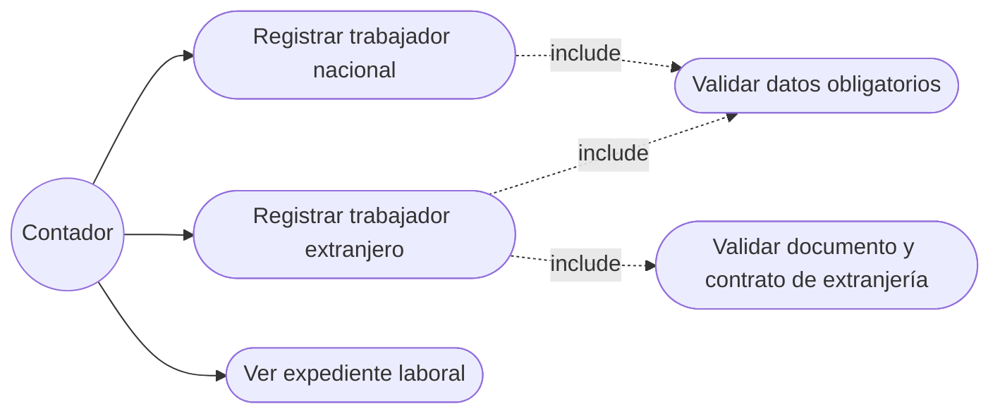
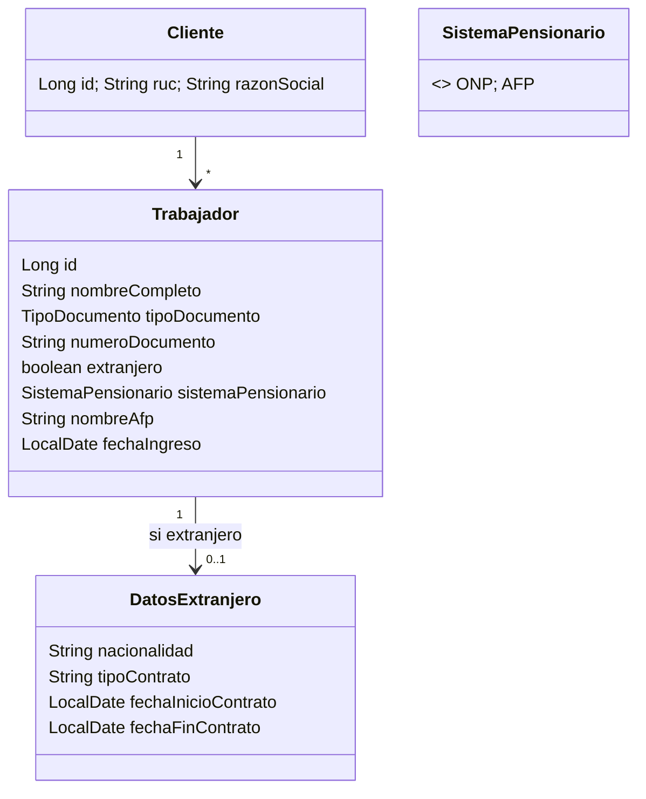

# HU-03 · Registrar la nómina de trabajadores

- [ ] 32 Análisis y diseño (este archivo) · [ ] 33 Interfaz · [ ] 34 BD · [ ] 35 API · [ ] 36 Unitarias · [ ] 37 Integración

## Caso de uso "Registrar trabajador" (borrador)

Flujo principal: el contador abre el expediente laboral de un cliente registrado, llena el formulario y guarda.
Alterno: faltan datos → no se guarda y se listan **todos** los campos faltantes.

## Diagrama de clases (borrador)

Implementación: una sola tabla `trabajadores`; `DatosExtranjero` son columnas obligatorias cuando `extranjero = true`.

## API

| Método | Ruta | |
|---|---|---|
| GET | `/api/tributario/clientes/{clienteId}/trabajadores` | Lista con sistema pensionario |
| POST | `/api/tributario/clientes/{clienteId}/trabajadores` | 400 `{mensaje}` con los campos faltantes |
