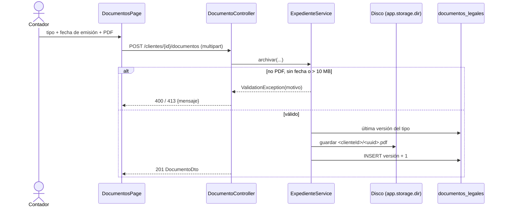

# HU-04 · Archivar documentos legales en el expediente digital

- [ ] 38 Análisis y diseño · [x] 39 Interfaz · [x] 40 BD · [x] 41 API · [x] 42 Unitarias · [ ] 43 Integración

Almacenamiento: disco local `./uploads/<clienteId>/<uuid>.pdf`, máximo 10 MB. Se acepta solo si el tipo es
`application/pdf` y el contenido empieza con `%PDF-`; fecha de emisión obligatoria y no futura.

## Caso de uso "Archivar documento legal" (borrador)

Actor: Contador. Tipos: minuta de constitución, vigencia de poderes, ficha RUC.
Precondición: cliente registrado. Postcondición: documento visible en el expediente con su fecha de emisión.
Alternos: no es PDF / supera el máximo / falta fecha de emisión → se rechaza indicando el motivo.

## Diagrama de secuencia: subida del PDF (borrador)

## API

| Método | Ruta |
|---|---|
| GET | `/api/tributario/clientes/{clienteId}/documentos` (todas las versiones, la mayor primero) |
| POST | `/api/tributario/clientes/{clienteId}/documentos` (`tipo`, `fechaEmision`, `archivo`) |
| GET | `/api/tributario/clientes/{clienteId}/documentos/{id}/archivo` |
