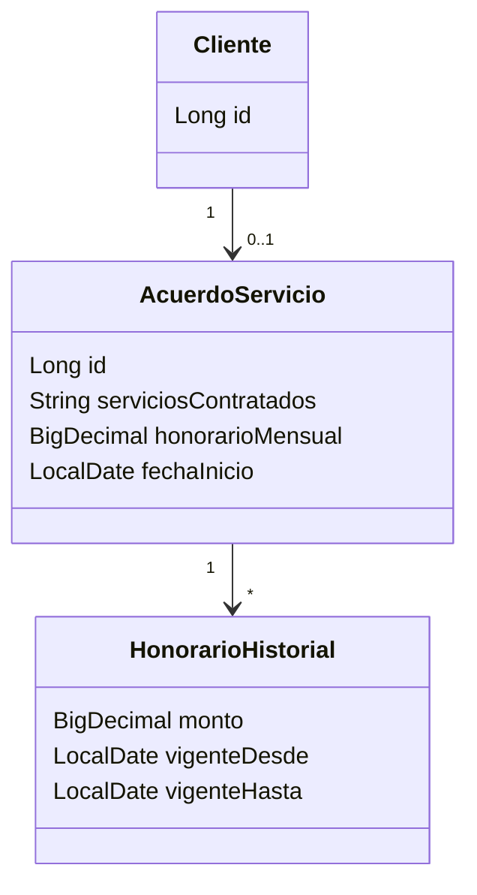

# HU-05 · Registrar el acuerdo de servicio y de honorarios

- [ ] 44 Análisis y diseño · [ ] 45 Interfaz · [ ] 46 BD · [ ] 47 API · [ ] 48 Unitarias · [ ] 49 Integración

## Caso de uso "Registrar acuerdo de servicio" (borrador)

Actor: Contador. Registra servicios contratados, honorario mensual (obligatorio) y fecha de inicio (obligatoria).
Al cambiar el honorario, el monto anterior queda en el historial con su vigencia. El acuerdo vigente se ve en la ficha del cliente.

## Diagrama de clases (borrador)

## API

| Método | Ruta |
|---|---|
| GET | `/api/tributario/clientes/{clienteId}/acuerdo` (vigente + historial) |
| PUT | `/api/tributario/clientes/{clienteId}/acuerdo` (crea o actualiza) |
