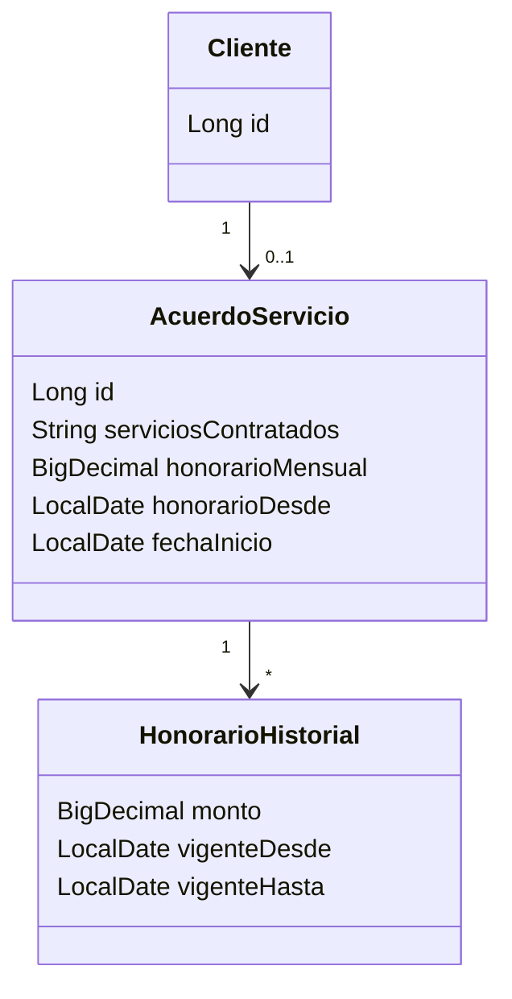

# HU-05 · Registrar el acuerdo de servicio y de honorarios

- [ ] 44 Análisis y diseño · [x] 45 Interfaz · [x] 46 BD · [x] 47 API · [x] 48 Unitarias · [ ] 49 Integración

Reglas: honorario mensual (> 0) y fecha de inicio obligatorios. `acuerdos_servicio.honorario_desde` guarda desde
cuándo rige el honorario actual. Al cambiar el monto se indica `honorarioDesde` (por defecto hoy, posterior al
inicio del actual) y el monto anterior pasa a `honorarios_historial` con vigencia
`[honorario_desde anterior, honorarioDesde − 1 día]`. Mismo monto: no genera historial.

## Caso de uso "Registrar acuerdo de servicio" (borrador)

Actor: Contador. Registra servicios contratados, honorario mensual (obligatorio) y fecha de inicio (obligatoria).
Al cambiar el honorario, el monto anterior queda en el historial con su vigencia. El acuerdo vigente se ve en la ficha del cliente.

## Diagrama de clases (borrador)

## API

| Método | Ruta |
|---|---|
| GET | `/api/tributario/clientes/{clienteId}/acuerdo` (vigente + historial) |
| PUT | `/api/tributario/clientes/{clienteId}/acuerdo` (crea o actualiza) |
