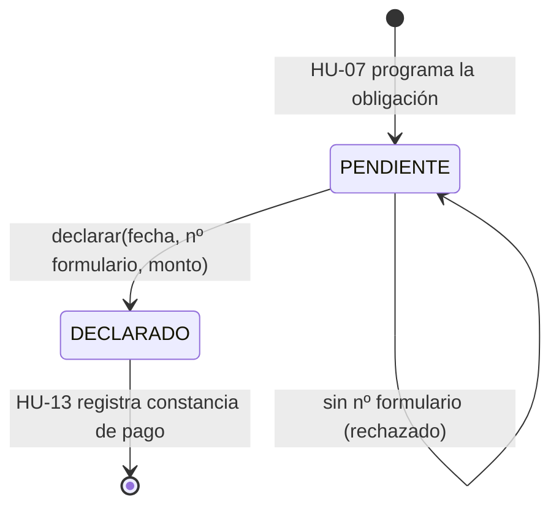

# HU-09 · Registrar la presentación de la declaración de un periodo

- [ ] 61 Análisis y diseño · [ ] 62 Interfaz · [ ] 63 API · [ ] 64 Unitarias · [ ] 65 Integración

> Depende de HU-07 (Ricardo). La obligación de esta rama es **provisional**.

## Caso de uso "Registrar declaración" (borrador)

Actor: Contador. Marca una obligación `PENDIENTE` como declarada con fecha, número de formulario y monto determinado.
Sin número de formulario no se acepta. La fecha y el formulario quedan consultables. HU-13 (Ricardo) espera `DECLARADO`.

## Diagrama de estados de la obligación (borrador)

## API

| Método | Ruta |
|---|---|
| PATCH | `/api/tributario/obligaciones/{id}/declaracion` |
| GET | `/api/tributario/obligaciones/{id}` |
