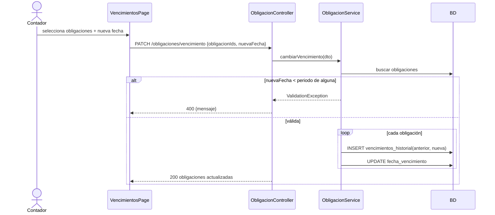

# HU-10 · Variar la fecha de vencimiento programada

- [ ] 66 Análisis y diseño · [ ] 67 Interfaz · [ ] 68 BD · [ ] 69 API · [ ] 70 Unitarias

> Depende de HU-07 (Ricardo). La obligación de esta rama es **provisional**.

## Caso de uso "Variar fecha de vencimiento" (borrador)

Actor: Contador. Selecciona una o varias obligaciones y una nueva fecha límite. Se guarda la fecha anterior en el historial.
Se rechaza (todas o ninguna) si la nueva fecha es anterior al periodo tributario de alguna obligación.

## Diagrama de secuencia (borrador)

